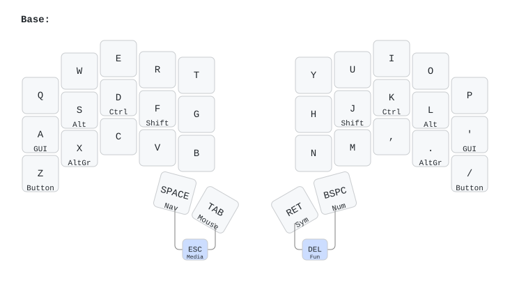
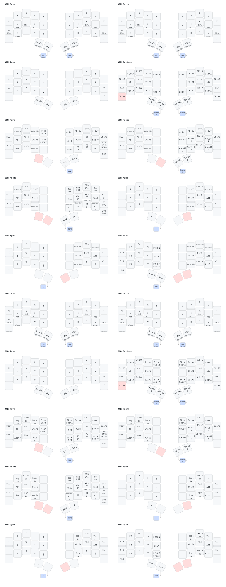

# Tako ZMK — Win/Mac 与 dongle / 左主双拓扑

本分支 `codex/tako-win-mac` 基于 `codex/tako-dongle` 增加 Win/Mac 模式；原 dongle 分支从稳定标签 `tako-analog-stable-2026-10-14`（`c262ce2`）创建。dongle 硬件与 [TOTEM feature/dongle_miryoku](https://github.com/GofranChang/zmk-config-totem/tree/feature/dongle_miryoku) 完全相同：nice!nano + I²C SH1106 128×64 OLED。

## Keymap

<!-- keymap:start -->



主字为点按，下方为长按；表格中的 `/` 分隔点按与长按。`2x` 表示双击切层；右上角标注为 Shift 功能。组合键框连接的按键需要同时按下。

| 左1 | 左2 | 左3 | 左4 | 左5 | 右1 | 右2 | 右3 | 右4 | 右5 |
|---|---|---|---|---|---|---|---|---|---|
| Q | W | E | R | T | Y | U | I | O | P |
| A / Win | S / Alt | D / Ctrl | F / Shift | G | H | J / Shift | K / Ctrl | L / Alt | &#x27; / Win |
| Z / WIN Button | X / AltGr | C | V | B | N | M | , | . / AltGr | / / WIN Button |

拇指键（左至右）：SPACE / WIN Nav；TAB / WIN Mouse；RET / WIN Sym；BSPC / WIN Num。

共 20 层：WIN Base、WIN Extra、WIN Tap、WIN Button、WIN Nav、WIN Mouse、WIN Media、WIN Num、WIN Sym、WIN Fun、MAC Base、MAC Extra、MAC Tap、MAC Button、MAC Nav、MAC Mouse、MAC Media、MAC Num、MAC Sym、MAC Fun。

<details>
<summary>展开全部层与组合键</summary>



</details>

<!-- keymap:end -->

键位图由 `.github/workflows/draw_keymap.yaml` 在每次分支 push 后重新生成，有变化时自动提交到同一分支；也可在 Actions 手动运行 **Draw ZMK keymaps**。直接解析 `tako.keymap` 及其包含的 Miryoku 宏，物理布局与固件共用 `tako-layouts.dtsi`。Studio 中保存的动态改键不在仓库里，不会反映到图中。

本地重绘（Python 3.12+）：

```sh
python -m pip install -r scripts/requirements-keymap.txt
python scripts/draw_keymap.py
```

## Win / Mac 模式

开机默认 **WIN**。按住左侧两个拇指键（Space + Tab 的组合键）进入 Media，然后单击实体 `P`，切换到 **MAC Base**；在 MAC 模式同样操作可回到 **WIN Base**。切换会回到目标系统的 Base 层，松开拇指后正常输入。模式保留到重启，不写入闪存，也不自动检测操作系统。

| 操作位置 | WIN | MAC |
| --- | --- | --- |
| Base / Extra：长按 D、K | Ctrl | Command |
| Base / Extra：长按 A、单引号 | Win | 真正的 Control |
| 所有功能层的 Ctrl / GUI 位置 | Ctrl / Win | Command / Control |
| Nav / Mouse / Button 复制、剪切、粘贴 | Ctrl+C / X / V | Command+C / X / V |
| 撤销 / 重做 | Ctrl+Z / Ctrl+Y | Command+Z / Command+Shift+Z |
| Nav：实体 N / 点号（原 Home / End） | Home / End | Command+← / → |
| Nav：实体 T / G（原空位） | Ctrl+← / →，前 / 后一个词 | Option+← / →，前 / 后一个词 |

Mac 的 Base / Extra 小指长按仍可发送真正 Ctrl，用于终端 Ctrl+C 等操作。Shift、Alt/Option、字母点按、数字符号、拇指键、鼠标及 USB/BLE 输出入口保持相同位置。Tap 层沿用 Miryoku 的无长按字母层，不增加 Home Row Mods。

层从同一份 Miryoku 模板生成：WIN 为 0–9，MAC 为 10–19。每套的 layer-tap、双击跳层和拇指组合键都只指向本系统的层，因此切 Num / Sym / Nav / Extra 不会丢失系统模式。实现位于 `modules/miryoku/tako_modes.dtsi`，无新增依赖。若通过 Studio 改键，两套层需分别修改；旧 Studio 设置可能覆盖原 0–9 层的改动，请在 Studio 恢复仓库键位后重新定制，不要用 settings_reset 擦除校准数据。

dongle 使用现有层状态组件，随当前层显示 `WIN Base`、`MAC Nav` 等名称；名称会在原位置滚动。底部的 Win 修饰键位图仍表示 GUI 键状态，图案不随模式切换，当前系统以层名称的 WIN / MAC 为准。左主屏若显示层名称，也使用同一套名称。

## 六个编译产物

`build.yaml` 一次固定生成以下六个 UF2；文件名显式区分两套连接方式。

| 文件名 | 用途 |
| --- | --- |
| `settings_reset.uf2` | 清空 nice!nano 设置；不是日常固件 |
| `tako_dongle.uf2` | nice!nano + SH1106 dongle 主设备，连接两半 |
| `tako_left_dongle.uf2` | dongle 模式左侧从设备 |
| `tako_right_dongle.uf2` | dongle 模式右侧从设备 |
| `tako_left_central.uf2` | 左侧 USB 连电脑的主设备，连接右半 |
| `tako_right_peripheral.uf2` | 左主右从模式的右侧从设备 |

两份右侧固件的配置和功能相同，分别命名便于成套选择。连接哪个主设备由蓝牙绑定决定，文件名本身不会指定绑定对象。左侧角色由构建项显式选择：默认从设备；左主构建通过 CMake 覆盖为 central，并开启 Studio。

## dongle 模式连接方式

```text
Tako 左半（BLE peripheral） ─┐
                           ├── nice!nano dongle（central）── USB ── 电脑
Tako 右半（BLE peripheral） ─┘
```

- dongle 是唯一主控，最多连接两半；Studio、Miryoku 层和按键处理在 dongle 上运行。主机蓝牙配置也属于 dongle。
- 此模式左右半均为无线外围设备。把左半 USB 接电脑可以充电和校准，但键盘输入仍经 dongle。左主右从模式直接使用同分支的另一组固件，见下文。
- 两半使用 Hammerbeam nice!view 幻灯片主题并保留电量状态、独立 USB 校准 Shell、原有 GPIO / MUX / ADC、50% 触发值、10/30 ms 扫描、矩阵断电 GPIO 停泊修复和 15 分钟深度睡眠。睡眠后按各半实体 reset 重启。
- 两半的空闲时间分别计算：只用一侧打字，另一侧仍可能在 15 分钟后深度睡眠。
- dongle 没有 EC 矩阵，使用 mock kscan；与两半共用同一份 34 键物理布局及矩阵映射，右侧保留 col-offset=5。USB 接通的 dongle 不进入深度睡眠。

## 左主右从模式

```text
Tako 右半（BLE peripheral）── Tako 左半（central）── USB ── 电脑
```

刷 `tako_left_central.uf2` + `tako_right_peripheral.uf2`。左半保留 Studio 和 EC 校准两个 CDC 端口；右半保留 EC 校准端口。左主最多连接一个右半；dongle 不参与此模式，请断开 dongle。

在两种拓扑间切换不是自动切主：需给左半刷对应角色固件，并清理两端旧蓝牙绑定后重新配对；右半只更新固件不会清除旧绑定。

## 输出切换、屏幕与符号层

- Media 层实体 `/` 键（原 `u_out_tog` 位置）直接切换 USB / 蓝牙输出，按住 Shift 也能切换。先将主设备（dongle 或左主）与目标电脑配对，并选择对应蓝牙配置；蓝牙未连接时，ZMK 会回退到可用的 USB 输出。从设备的 USB 仍用于充电和校准。
- dongle 的 SH1106 OLED 使用 `inversion-on` 整体翻转原有配色，位图小组件也一起翻转。
- 所有 Tako 屏幕在 USB 供电时持续显示，即使选择蓝牙输出也不熄屏。插入 USB 会唤醒空闲屏幕，拔掉后恢复按活动状态熄屏；电池供电时，幻灯片从设备在空闲状态继续每 20 秒换图，直到原有 15 分钟深度睡眠；其他显示仍按活动状态省电。
- Sym 层（长按右侧 Enter 拇指键）：实体 `I` 输出 `Esc`，`,` 输出 `(`，`.` 输出 `)`；Base 层不变。
- `config/boards/shields/tako/usb_display.c` 统一管理屏幕熄屏，保持 `CONFIG_ZMK_DISPLAY_BLANK_ON_IDLE=n`，避免上游的空闲监听器同时控制屏幕。该实现使用固定 ZMK v0.3 的显示刷新定时器。
- 主设备上已有的 Studio 动态改键可能覆盖仓库键位；刷机后若按键不一致，请在 Studio 更新对应绑定。

## OLED 与依赖

OLED 配置逐项参照 TOTEM 的 `totem_dongle.overlay`：`pro_micro_i2c`（nice!nano SDA=P0.17、SCL=P0.20）、地址 0x3c、SH1106、128×64、segment-offset=2、multiplex-ratio=63、segment-remap、com-invdir、prechargep=0x22。电源接法沿用同款硬件。

dongle 使用 `englmaxi/zmk-dongle-display` 的 v0.3 兼容提交 `c6c4be11c5ede722086a2a1f355cec9c101b9390`，提供两半数字电量、层、连接、修饰键和猫动画等状态。电量来源编号按外围设备的配对槽位确定；首次配对先启动左半，再启动右半。

ZMK 保持 v0.3，因此 board 名仍为 `nice_nano_v2`，没有照搬新版 `nice_nano//zmk`。analog-matrix-module 固定 `3cb997880834b7147f96107d7564840f0013af1c`，保留已验证的功耗和闲置响应修复。参考仓库的 `zmk-nice-oled` 没有用于 dongle 构建，本分支不添加该无关依赖。

## 编译与固件

GitHub Actions 读取 `build.yaml`，一次生成上述六个固件，使用独立 artifact-name，两个右侧构建不会互相覆盖。远程构建前，须先将驱动仓库的固定提交推送到 GitHub，再推送本配置分支。

已配置的本地环境：

```sh
cd /Users/gofran/Documents/workspace/keyboard/zmk-local
./build-tako.sh all          # 一次构建六个固件（默认）
./build-tako.sh dongle-set   # dongle + 左右从设备，共三个
./build-tako.sh wired-set    # 左主 + 右从，共两个
./build-tako.sh both         # dongle 模式的左右从设备
./build-tako.sh left-central # 仅左主
./build-tako.sh dongle       # 仅 dongle
./build-tako.sh reset        # 仅 settings_reset
```

本地输出与远程 artifact-name 相同，位于 `zmk-local/firmware/`。仅左主和 dongle 启用 Studio snippet；所有实际键盘半边均保留 calibrator snippet。

## 首次迁移与配对

**不要对两半直接刷 settings_reset：它会擦除 EC 校准数据。** 以下迁移没有更改 EC 校准存储路径。

1. 切换前分别用 USB 连接两半，运行 `ec KSCAN calibration export`，保存一份现有校准备份。
2. 编译临时解绑固件：`./build-tako.sh dongle-set --clear-bonds`。它使用 `CONFIG_ZMK_BLE_CLEAR_BONDS_ON_START=y`，只删除蓝牙绑定及 ZMK 的主机/外围地址记录，不清除 EC 校准数据；输出名带 `-clear-bonds.uf2`。
3. 三个设备分别刷入对应的临时解绑固件，退出 UF2 引导模式后让它正常启动几秒。该临时固件每次启动都会清绑定，不能留作日常使用。
4. 再执行 `./build-tako.sh dongle-set`，给三个设备刷入表中对应的正常固件（不带 `-clear-bonds`）。新固件仍可保留当前校准值，无需重做校准。
5. 关闭两半，dongle 接电脑；先启动左半并测试按键，再启动右半并测试。之后正常使用会自动重连。
6. 如果 dongle 原本刷的是另一把键盘且存在 Studio 改键数据，可以仅对 dongle 使用 settings_reset，再刷回 dongle 固件；它不存储两半的 EC 校准数据。settings_reset 是清空设置的固件，不是日常键盘固件。

之后仅更新固件通常无需再次清绑定。需要切换为左主右从时，先用 `./build-tako.sh wired-set --clear-bonds` 编译并给两半刷入临时解绑固件，启动后再用 `./build-tako.sh wired-set` 的正常左主 / 右从固件覆盖；不要让临时解绑版长期运行。

## 校准与数字电量

dongle 模式日常只将 dongle 插电脑。校准时需要 USB **直接连接待校准的半边**，dongle 不转发校准串口。dongle 模式两半各只有校准 Shell CDC；Studio 在 dongle 上。左主右从模式则在左半保留 Studio 和校准两个 CDC，选择有 Shell 提示符的端口。

```text
ec
ec KSCAN calibration start
ec KSCAN calibration save
ec KSCAN calibration export
ec KSCAN calibration load
```

开始校准后低值采样时全部松开；高值采样时逐颗按到底并保持，收到完成提示后松开，共 17 颗。完成后 save，重启读取并测试。Flash 路径仍为 `zmk/ec/cal/KSCAN`；坐标是 `(MUX 列索引, strobe 行索引)`，两组数组各 20 项。配套上位机选择 analog-matrix 协议。

nice!view 使用 [GPeye/hammerbeam-slideshow](https://github.com/GPeye/hammerbeam-slideshow)，固定提交 `9c16436efa4c87d19e2e4558927969c7ddd5851d`。30 张图片每张显示 20 秒，`CONFIG_CUSTOM_ANIMATION_SPEED=600000` 是整轮 600 秒的时长，并非单张时长。dongle 模式左右半均为从设备，两块屏都会播放；左主右从模式下，左主使用主题自带状态界面，右从播放。幻灯片在电池空闲时继续播放，15 分钟后仍会深度睡眠；USB 供电时持续播放。dongle 的 SH1106 OLED 保持原有主题。电量仍是电压估算，并非电流或精确容量测量。dongle 模式左右屏不显示 dongle 上的实时层状态；层状态请看 dongle OLED。左主右从模式的层状态在左主设备屏幕显示。

## 验证范围

2026-10-16：Win/Mac 版本已在现有 macOS ZMK v0.3 工具链上完成六目标编译：settings_reset、dongle、左从、右从、左主、右外围。两份右侧固件 SHA-256 相同。随后将系统切换入口移至 Media 层 P，重新编译 dongle 和左主并通过对应键位检查；该入口现为单击切换。没有刷写设备。

对五份实际键盘构建的 `edt.pickle` 运行 `scripts/verify_modes.py`，确认二十层各有 34 个键位、共 24 个拇指组合键；两套 layer-tap / 双击跳层 / 组合键的目标层正确；Ctrl / Command、三处剪贴板层、跳词、行首行尾和系统切换均符合模式。键位图生成通过并检查了两套 Base 图。

复查方法（使用本地 Zephyr 的 Python 环境，仅加载自己编译生成的 pickle）：

```sh
PYTHONPATH=../zmk-local/zephyr/scripts/dts/python-devicetree/src \
  ../zmk-local/.venv/bin/python scripts/verify_modes.py \
  ../zmk-local/build/win-mac-tako_dongle/zephyr/edt.pickle \
  ../zmk-local/build/win-mac-tako_left_central/zephyr/edt.pickle
```

本地若未下载 `hammerbeam-slideshow`，先按上文运行 `./build-tako.sh all --update`，同步 west.yml 中固定的依赖；本次编译使用该固定提交的临时副本，通过 `TAKO_EXTRA_MODULES` 指定，不改变依赖版本。

此前已通过 EDT 对比确认 EC / MUX 属性与稳定固件一致。本次未修改矩阵、电源、校准、蓝牙绑定或屏幕熄屏策略。尚未实机验证 Win/Mac 快捷键、切换操作手感及屏幕显示；编译和静态键位检查不能代替这些验证。
